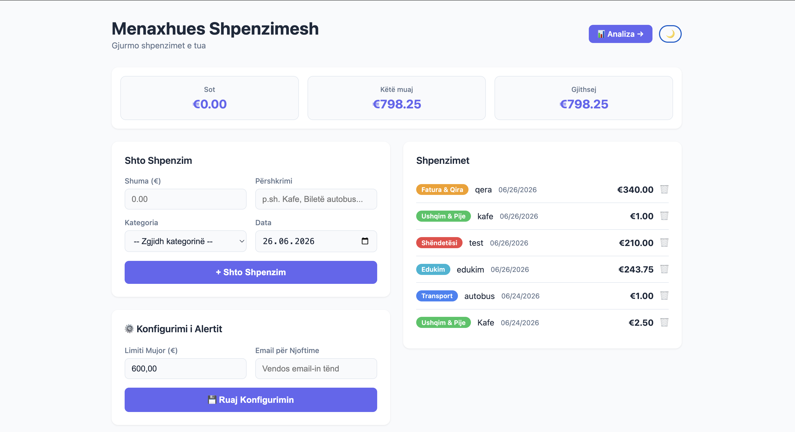
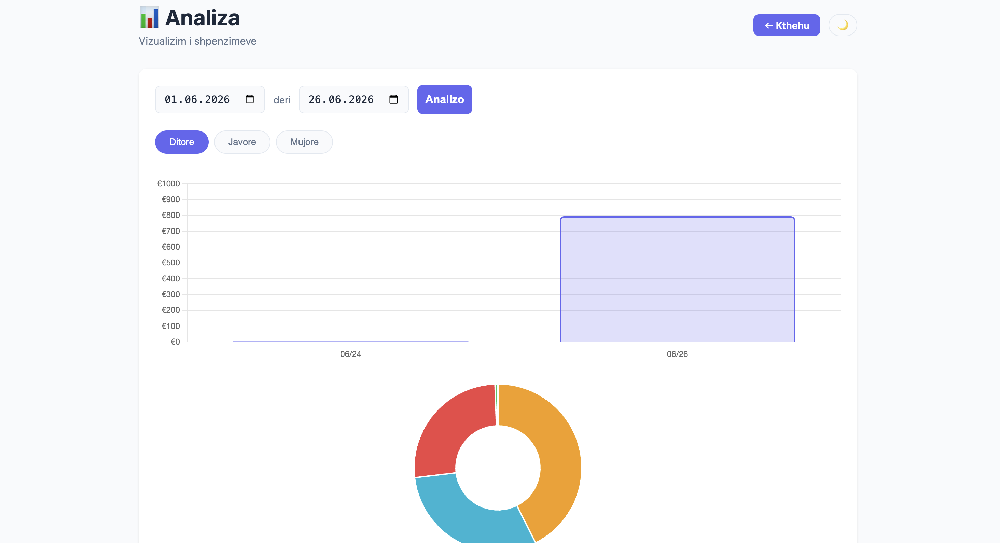

# Menaxhues Shpenzimesh

Aplikacion web për gjurmimin e shpenzimeve personale.



## Stack
- **Frontend:** HTML, CSS, Vanilla JavaScript, Chart.js
- **Backend:** Node.js + Express
- **Databaza:** PostgreSQL
- **Email:** Nodemailer (Gmail SMTP) + node-cron

## Funksionalitetet
- Shto dhe fshi shpenzime me kategori, përshkrim dhe datë
- Statistika: totali i sotëm, mujor dhe gjithsej
- 8 kategori të para-ndërtuara me ngjyra
- Faqja e analizës: grafik ditor/javor/mujor, ndarje sipas kategorive dhe filtër sipas periudhës
- Dark mode
- Alert me email kur kalohet limiti mujor (një herë në muaj), plus raport javor dhe mujor

| Analiza | Dark mode |
|---|---|
|  |  |

## Struktura
```
expense-manager/
├── backend/
│   ├── routes/
│   │   ├── alertConfig.js
│   │   ├── categories.js
│   │   ├── expenses.js
│   │   └── stats.js
│   ├── services/
│   │   └── emailService.js
│   ├── test/              # node:test — njësie + integrimi
│   ├── db.js
│   ├── server.js
│   ├── validation.js
│   └── .env.example
├── database/
│   ├── schema.sql         # tabelat, view-t, kategoritë fillestare
│   └── migrations/
├── frontend/
│   ├── css/style.css
│   ├── js/
│   │   ├── api.js
│   │   ├── charts.js
│   │   ├── main.js
│   │   ├── ui.js
│   │   └── utils.js       # escapeHtml, datat lokale
│   ├── analysis.html
│   └── index.html
└── docs/                  # screenshots
```

## Instalimi
```bash
# 1. Klono repon
git clone https://github.com/DrinSelmonaj/expense-manager.git
cd expense-manager

# 2. Krijo databazën
psql -U postgres -c "CREATE DATABASE expense_manager;"
psql -U postgres -d expense_manager -f database/schema.sql

# 3. Konfiguro dhe instalo backend-in
cd backend
cp .env.example .env      # plotëso DB_USER, DB_PASSWORD dhe (opsionale) email-in
npm install

# 4. Starto serverin (http://localhost:3000)
npm start

# 5. Hap frontend/index.html me Live Server
```

Për alertet me email, `EMAIL_PASS` duhet të jetë një [App Password](https://support.google.com/accounts/answer/185833) i Gmail, jo fjalëkalimi i llogarisë.

Nëse databaza është krijuar para tabelës `alert_log`, ekzekuto edhe `database/migrations/001_alert_log.sql`.

## Testet
```bash
cd backend && npm test
```
10 teste automatike (`node:test`) plus testet manuale; udhëzimet e plota dhe databaza e veçantë për teste janë te [TESTING.md](TESTING.md).

## API Endpoints
| Method | URL | Funksioni |
|--------|-----|-----------|
| GET | /api/categories | Merr të gjitha kategoritë |
| POST | /api/categories | Krijo kategori të re |
| GET | /api/expenses | Merr të gjitha shpenzimet |
| POST | /api/expenses | Shto shpenzim të ri |
| DELETE | /api/expenses/:id | Fshi shpenzim |
| GET | /api/stats/daily | Totalet ditore, 30 ditët e fundit |
| GET | /api/stats/weekly | Totalet javore, 12 javët e fundit |
| GET | /api/stats/monthly | Totalet mujore |
| GET | /api/stats/by-category | Totalet sipas kategorisë |
| GET | /api/stats/range?from=YYYY-MM-DD&to=YYYY-MM-DD | Totalet ditore dhe sipas kategorisë për një periudhë |
| GET | /api/alert-config | Merr email-in dhe limitin mujor |
| POST | /api/alert-config | Ruaj email-in dhe limitin mujor |

Input-et e pavlefshme (shumë, datë, ID, email) kthejnë `400` me mesazh, jo `500`.
